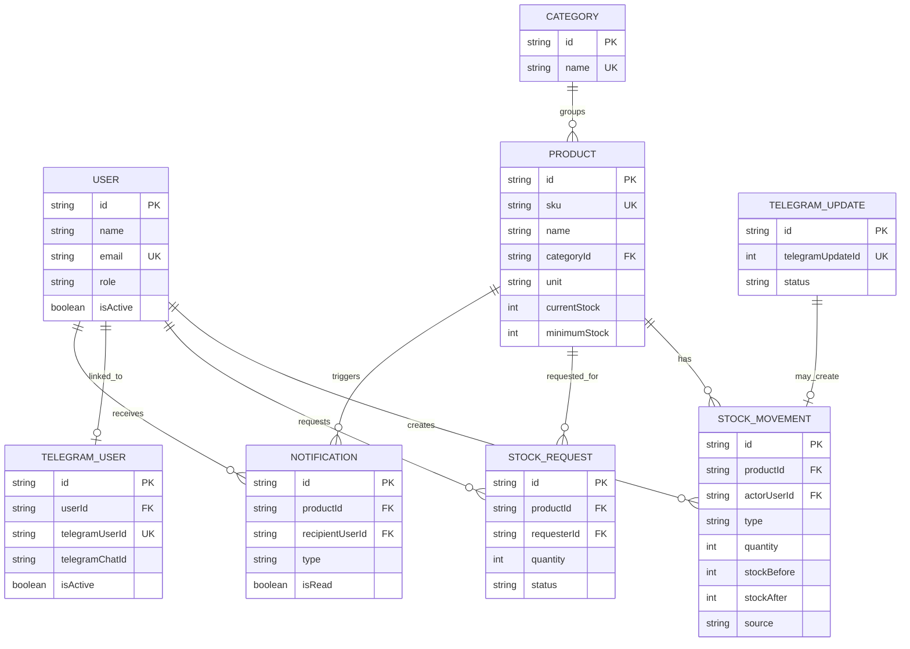

# Database Schema — StockFlow
## PostgreSQL + Prisma ORM

**Versi:** 1.0  
**Tujuan:** Menjadi rancangan data yang konsisten untuk aplikasi Inventory Management System StockFlow.

---

## 1. Prinsip Perancangan

Database dirancang agar:
- Informasi barang terpisah dari riwayat pergerakan stok.
- Setiap perubahan stok dapat ditelusuri.
- Identitas Telegram dapat dihubungkan dengan akun internal.
- Pesan Telegram yang sama tidak diproses dua kali.
- Permintaan yang memerlukan approval dapat disimpan tanpa langsung mengubah stok.
- Data historis tetap tersedia walaupun barang atau pengguna dinonaktifkan.

### Keputusan penting
**`products.currentStock` adalah saldo terkini untuk pembacaan cepat, sedangkan `stock_movements` adalah jejak audit.** Keduanya harus diperbarui dalam satu transaksi database. Secara berkala, saldo produk dapat direkonsiliasi dengan penjumlahan movement dan saldo awal/penyesuaian.

Satu produk menggunakan satu satuan dasar. Konversi seperti 1 box = 12 pcs tidak termasuk rancangan MVP.

## 2. ERD Konseptual



## 3. Entitas dan Kolom

### 3.1 `User`
Menyimpan akun internal.

| Kolom | Tipe | Aturan | Keterangan |
|---|---|---|---|
| id | UUID | PK | ID internal |
| name | varchar | wajib | Nama pengguna |
| email | varchar | unique, wajib | Email login |
| passwordHash | varchar | opsional sesuai Auth.js/provider | Jangan simpan password asli |
| role | enum | wajib | `ADMIN`, `USER` |
| isActive | boolean | default true | Status akses |
| createdAt | timestamptz | otomatis | Waktu dibuat |
| updatedAt | timestamptz | otomatis | Waktu diubah |

### 3.2 `Category`
Kategori master barang.

| Kolom | Tipe | Aturan | Keterangan |
|---|---|---|---|
| id | UUID | PK | ID kategori |
| name | varchar | unique, wajib | Nama kategori |
| description | text | nullable | Penjelasan |
| createdAt | timestamptz | otomatis | Waktu dibuat |
| updatedAt | timestamptz | otomatis | Waktu diubah |

### 3.3 `Product`
Master barang dan saldo saat ini.

| Kolom | Tipe | Aturan | Keterangan |
|---|---|---|---|
| id | UUID | PK | ID barang |
| sku | varchar | unique, wajib | Kode barang |
| name | varchar | wajib | Nama barang |
| description | text | nullable | Deskripsi |
| categoryId | UUID | FK, nullable | Kategori |
| unit | varchar | wajib | Satuan dasar |
| currentStock | integer | default 0, >= 0 | Saldo terkini |
| minimumStock | integer | default 0, >= 0 | Ambang minimum |
| isActive | boolean | default true | Barang aktif/nonaktif |
| createdAt | timestamptz | otomatis | Waktu dibuat |
| updatedAt | timestamptz | otomatis | Waktu diubah |

Indeks yang disarankan: `sku` unique, `name`, `categoryId`, `isActive`.

### 3.4 `StockMovement`
Ledger pergerakan stok. Satu baris mewakili satu perubahan kuantitas.

| Kolom | Tipe | Aturan | Keterangan |
|---|---|---|---|
| id | UUID | PK | ID movement |
| productId | UUID | FK, wajib | Barang |
| actorUserId | UUID | FK, nullable untuk proses sistem | Pelaku |
| type | enum | wajib | `IN`, `OUT`, `ADJUSTMENT`, `REVERSAL` |
| quantity | integer | > 0 | Besaran perubahan absolut |
| stockBefore | integer | >= 0 | Saldo sebelum |
| stockAfter | integer | >= 0 | Saldo sesudah |
| source | enum | wajib | `WEB`, `TELEGRAM`, `SYSTEM` |
| referenceId | UUID/string | nullable | Referensi request atau movement asal |
| notes | text | nullable | Catatan/keperluan |
| telegramUpdateId | integer | unique nullable | Update Telegram pemicu |
| createdAt | timestamptz | otomatis | Waktu transaksi |

**Makna quantity:** selalu positif; arah ditentukan oleh `type`. Untuk `IN`, saldo bertambah. Untuk `OUT`, saldo berkurang. Untuk `ADJUSTMENT`, aplikasi harus menyimpan arah/selisih secara eksplisit; implementasi yang lebih sederhana dapat memakai dua tipe `ADJUSTMENT_IN` dan `ADJUSTMENT_OUT` atau kolom `delta` bertanda. Pilih satu pendekatan secara konsisten sebelum migrasi pertama.

Rekomendasi implementasi yang paling mudah diaudit: gunakan `delta` bertanda integer, `stockBefore`, `stockAfter`, dan `type` sebagai klasifikasi. Jika memakai `quantity` positif, tentukan aturan tanda secara ketat pada service layer.

### 3.5 `TelegramUser`
Menghubungkan akun internal dengan identitas Telegram.

| Kolom | Tipe | Aturan | Keterangan |
|---|---|---|---|
| id | UUID | PK | ID relasi |
| userId | UUID | FK, unique | Akun internal |
| telegramUserId | varchar | unique, wajib | Telegram user ID |
| telegramChatId | varchar | wajib | Chat tujuan balasan |
| username | varchar | nullable | Username Telegram |
| isActive | boolean | default true | Izin integrasi |
| linkedAt | timestamptz | otomatis | Waktu terhubung |

Simpan ID Telegram sebagai string untuk menghindari asumsi ukuran integer lintas platform.

### 3.6 `TelegramUpdate`
Mencegah update Telegram diproses berulang dan menyediakan jejak pemrosesan.

| Kolom | Tipe | Aturan | Keterangan |
|---|---|---|---|
| id | UUID | PK | ID internal |
| telegramUpdateId | bigint | unique | ID update Telegram |
| chatId | varchar | nullable | Asal chat |
| telegramUserId | varchar | nullable | Pengirim |
| payload | jsonb | nullable/terbatas | Payload yang telah disaring |
| status | enum | wajib | `RECEIVED`, `PROCESSING`, `PROCESSED`, `FAILED`, `IGNORED` |
| errorMessage | text | nullable | Ringkasan error tanpa secret |
| receivedAt | timestamptz | otomatis | Diterima |
| processedAt | timestamptz | nullable | Selesai diproses |

Jangan menyimpan data pribadi yang tidak diperlukan. Terapkan retensi log dan pembatasan akses.

### 3.7 `StockRequest`
Permintaan pengambilan yang belum tentu langsung mengurangi stok.

| Kolom | Tipe | Aturan | Keterangan |
|---|---|---|---|
| id | UUID | PK | ID permintaan |
| productId | UUID | FK | Barang |
| requesterId | UUID | FK | Peminta |
| quantity | integer | > 0 | Jumlah diminta |
| notes | text | nullable | Keperluan |
| status | enum | wajib | `PENDING`, `APPROVED`, `REJECTED`, `CANCELLED`, `FULFILLED` |
| reviewedById | UUID | FK nullable | Admin peninjau |
| reviewedAt | timestamptz | nullable | Waktu peninjauan |
| fulfilledMovementId | UUID | unique nullable | Movement saat barang benar-benar keluar |
| createdAt | timestamptz | otomatis | Dibuat |
| updatedAt | timestamptz | otomatis | Diubah |

Untuk direct issue, sistem dapat membuat movement langsung tanpa membuat request pending. Jika semua pengambilan perlu workflow approval, buat request terlebih dahulu dan kurangi stok hanya saat fulfillment/approval sesuai kebijakan.

### 3.8 `Notification`
Notifikasi dalam aplikasi.

| Kolom | Tipe | Aturan | Keterangan |
|---|---|---|---|
| id | UUID | PK | ID notifikasi |
| productId | UUID | FK nullable | Barang terkait |
| recipientUserId | UUID | FK nullable | Penerima; null dapat berarti broadcast admin |
| type | enum | wajib | `LOW_STOCK`, `OUT_OF_STOCK`, `SYSTEM` |
| message | text | wajib | Isi notifikasi |
| isRead | boolean | default false | Status baca |
| dedupeKey | varchar | unique nullable | Cegah notifikasi duplikat |
| createdAt | timestamptz | otomatis | Waktu dibuat |

## 4. Relasi dan Kardinalitas

- Satu kategori memiliki banyak produk; satu produk maksimal berada pada satu kategori.
- Satu produk memiliki banyak stock movement.
- Satu pengguna dapat membuat banyak stock movement.
- Satu pengguna memiliki maksimal satu tautan Telegram aktif dalam rancangan sederhana ini.
- Satu pengguna dapat membuat banyak stock request.
- Satu produk dapat memiliki banyak stock request.
- Satu produk dapat memicu banyak notifikasi sepanjang waktu.
- Satu Telegram update hanya boleh diproses sekali.

## 5. Indeks dan Constraint

Wajib:
- Unique: `User.email`, `Category.name`, `Product.sku`, `TelegramUser.telegramUserId`, `TelegramUser.userId`, `TelegramUpdate.telegramUpdateId`.
- Check: `Product.currentStock >= 0`, `Product.minimumStock >= 0`, `StockRequest.quantity > 0`, `StockMovement.quantity > 0` (jika quantity positif).
- Index: `StockMovement(productId, createdAt)`, `StockMovement(actorUserId, createdAt)`, `StockRequest(status, createdAt)`, `Product(isActive, name)`, `Notification(recipientUserId, isRead, createdAt)`.
- Foreign key memakai kebijakan `Restrict`/soft deactivate untuk data historis penting; hindari cascade delete pada ledger.

## 6. Contoh Prisma Schema (fondasi)

> Contoh ini adalah fondasi yang perlu diselaraskan dengan versi Prisma, provider autentikasi, dan keputusan tipe adjustment sebelum dipakai untuk migrasi produksi.

```prisma
generator client {
  provider = "prisma-client-js"
}

datasource db {
  provider = "postgresql"
  url      = env("DATABASE_URL")
}

enum Role {
  ADMIN
  USER
}

enum MovementType {
  IN
  OUT
  ADJUSTMENT
  REVERSAL
}

enum MovementSource {
  WEB
  TELEGRAM
  SYSTEM
}

enum TelegramUpdateStatus {
  RECEIVED
  PROCESSING
  PROCESSED
  FAILED
  IGNORED
}

enum RequestStatus {
  PENDING
  APPROVED
  REJECTED
  CANCELLED
  FULFILLED
}

enum NotificationType {
  LOW_STOCK
  OUT_OF_STOCK
  SYSTEM
}

model User {
  id             String         @id @default(uuid()) @db.Uuid
  name           String
  email          String         @unique
  passwordHash   String?
  role           Role           @default(USER)
  isActive       Boolean        @default(true)
  movements      StockMovement[]
  requests       StockRequest[] @relation("Requester")
  reviews        StockRequest[] @relation("Reviewer")
  telegram       TelegramUser?
  notifications  Notification[]
  createdAt      DateTime       @default(now())
  updatedAt      DateTime       @updatedAt
}

model Category {
  id          String    @id @default(uuid()) @db.Uuid
  name        String    @unique
  description String?
  products    Product[]
  createdAt   DateTime  @default(now())
  updatedAt   DateTime  @updatedAt
}

model Product {
  id            String          @id @default(uuid()) @db.Uuid
  sku           String          @unique
  name          String
  description   String?
  categoryId    String?         @db.Uuid
  category      Category?       @relation(fields: [categoryId], references: [id], onDelete: Restrict)
  unit          String
  currentStock  Int             @default(0)
  minimumStock  Int             @default(0)
  isActive      Boolean         @default(true)
  movements     StockMovement[]
  requests      StockRequest[]
  notifications Notification[]
  createdAt     DateTime        @default(now())
  updatedAt     DateTime        @updatedAt

  @@index([isActive, name])
  @@index([categoryId])
}

model StockMovement {
  id               String         @id @default(uuid()) @db.Uuid
  productId        String         @db.Uuid
  product          Product        @relation(fields: [productId], references: [id], onDelete: Restrict)
  actorUserId      String?        @db.Uuid
  actor            User?          @relation(fields: [actorUserId], references: [id], onDelete: SetNull)
  type             MovementType
  quantity         Int
  stockBefore      Int
  stockAfter       Int
  source           MovementSource
  referenceId      String?
  notes            String?
  telegramUpdateId BigInt?        @unique
  createdAt        DateTime       @default(now())

  @@index([productId, createdAt])
  @@index([actorUserId, createdAt])
}

model TelegramUser {
  id              String   @id @default(uuid()) @db.Uuid
  userId          String   @unique @db.Uuid
  user            User     @relation(fields: [userId], references: [id], onDelete: Restrict)
  telegramUserId  String   @unique
  telegramChatId  String
  username        String?
  isActive        Boolean  @default(true)
  linkedAt        DateTime @default(now())
}

model TelegramUpdate {
  id               String                @id @default(uuid()) @db.Uuid
  telegramUpdateId BigInt                @unique
  chatId           String?
  telegramUserId   String?
  payload          Json?
  status           TelegramUpdateStatus  @default(RECEIVED)
  errorMessage     String?
  receivedAt       DateTime              @default(now())
  processedAt      DateTime?
}

model StockRequest {
  id                  String        @id @default(uuid()) @db.Uuid
  productId           String        @db.Uuid
  product             Product       @relation(fields: [productId], references: [id], onDelete: Restrict)
  requesterId         String        @db.Uuid
  requester           User          @relation("Requester", fields: [requesterId], references: [id], onDelete: Restrict)
  quantity            Int
  notes               String?
  status              RequestStatus @default(PENDING)
  reviewedById        String?       @db.Uuid
  reviewedBy          User?         @relation("Reviewer", fields: [reviewedById], references: [id], onDelete: SetNull)
  reviewedAt          DateTime?
  fulfilledMovementId String?       @unique @db.Uuid
  createdAt           DateTime      @default(now())
  updatedAt           DateTime      @updatedAt

  @@index([status, createdAt])
  @@index([requesterId, createdAt])
}

model Notification {
  id              String           @id @default(uuid()) @db.Uuid
  productId       String?          @db.Uuid
  product         Product?         @relation(fields: [productId], references: [id], onDelete: SetNull)
  recipientUserId String?          @db.Uuid
  recipient       User?            @relation(fields: [recipientUserId], references: [id], onDelete: Cascade)
  type            NotificationType
  message         String
  isRead          Boolean          @default(false)
  dedupeKey       String?          @unique
  createdAt       DateTime         @default(now())

  @@index([recipientUserId, isRead, createdAt])
}
```

## 7. Logika Transaksi Stok

Contoh konsep barang keluar:

```ts
await prisma.$transaction(async (tx) => {
  // Conditional update mencegah stok turun di bawah nol.
  const result = await tx.product.updateMany({
    where: {
      id: productId,
      isActive: true,
      currentStock: { gte: quantity },
    },
    data: {
      currentStock: { decrement: quantity },
    },
  });

  if (result.count !== 1) {
    throw new Error("Barang tidak ditemukan, nonaktif, atau stok tidak mencukupi");
  }

  const productAfter = await tx.product.findUniqueOrThrow({
    where: { id: productId },
  });

  await tx.stockMovement.create({
    data: {
      productId,
      actorUserId: userId,
      type: "OUT",
      quantity,
      stockBefore: productAfter.currentStock + quantity,
      stockAfter: productAfter.currentStock,
      source: "TELEGRAM",
      telegramUpdateId,
      notes,
    },
  });
});
```

**Catatan implementasi:** conditional update dan unique `telegramUpdateId` perlu digabung dengan penanganan idempotensi update. Jika insert movement gagal, seluruh transaksi harus rollback. Untuk kebutuhan konkurensi tinggi, evaluasi isolation level dan locking sesuai beban.

## 8. Strategi Idempotensi Webhook

1. Terima update Telegram dan validasi secret header.
2. Coba insert `TelegramUpdate` dengan `telegramUpdateId` unik.
3. Jika unique conflict, berarti update sudah pernah diterima; jangan ulangi transaksi stok.
4. Proses update dalam transaksi yang konsisten.
5. Tandai `PROCESSED` setelah transaksi bisnis berhasil.
6. Jika gagal, catat status `FAILED` dan error yang aman untuk log.
7. Retry harus dapat membedakan kegagalan sebelum dan sesudah commit.

Untuk sistem yang memerlukan jaminan lebih kuat, gunakan pola inbox/outbox atau status pemrosesan dengan lease/lock. Jangan hanya mengandalkan pemeriksaan di memori.

## 9. Saldo Awal dan Rekonsiliasi

- Saat migrasi awal, buat saldo awal sebagai movement `IN` atau `ADJUSTMENT` dengan catatan `Saldo awal migrasi`.
- Jangan mengisi `currentStock` secara langsung tanpa movement pendamping.
- Rekonsiliasi berkala membandingkan saldo produk dengan hasil ledger.
- Koreksi selisih dibuat sebagai movement adjustment yang menyimpan alasan dan aktor.

## 10. Retensi, Backup, dan Privasi

- Backup database harian dan sebelum migrasi besar.
- Uji pemulihan backup, bukan hanya keberhasilan backup.
- Batasi akses ke payload Telegram.
- Jangan mencatat token bot, secret webhook, password, atau data sensitif ke log.
- Tentukan kebijakan retensi log webhook dan notifikasi.
- Gunakan soft deactivate untuk barang dan akun yang memiliki histori.

## 11. Checklist Sebelum Migrasi Pertama

- [ ] Tetapkan tipe dan aturan adjustment.
- [ ] Tetapkan apakah approval dipakai di MVP atau hanya disiapkan.
- [ ] Tetapkan satuan dasar dan larangan konversi.
- [ ] Tetapkan strategi autentikasi.
- [ ] Tambahkan constraint database untuk nilai nonnegatif.
- [ ] Uji transaksi bersamaan.
- [ ] Uji webhook duplikat.
- [ ] Uji rollback ketika insert movement gagal.
- [ ] Uji rekonsiliasi saldo.
