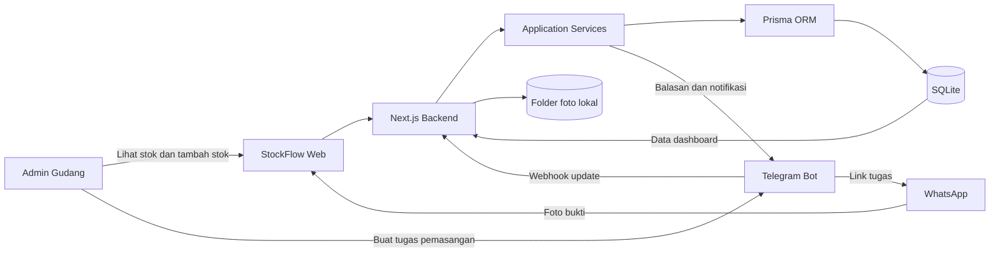
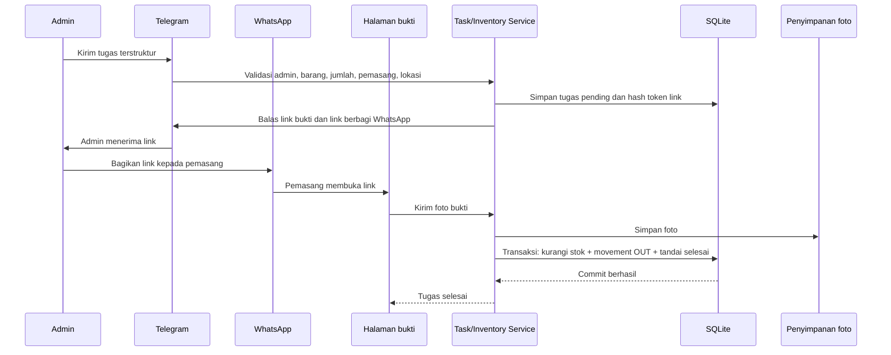

# System Architecture — StockFlow
## Arsitektur Aplikasi Web dan Integrasi Telegram

**Versi:** 1.0  
**Stack utama:** Next.js, TypeScript, Prisma ORM, SQLite, Telegram Bot API

---

## 1. Gambaran Arsitektur

StockFlow menggunakan pendekatan aplikasi full-stack modular. Next.js menangani antarmuka web dan endpoint backend. Prisma menjadi lapisan akses data ke SQLite pada server lokal. Telegram Bot API menerima tugas admin melalui webhook. Vercel hanya digunakan untuk demo karena database SQLite dan file foto di filesystem instance tidak persisten.

### Komponen utama
1. **Admin Web:** dashboard dan halaman pengelolaan inventori.
2. **Next.js Application:** UI, autentikasi, API/Route Handler, dan business logic.
3. **Application Services:** aturan stok, pengguna, notifikasi, dan Telegram.
4. **Prisma ORM:** komunikasi terstruktur dengan database.
5. **SQLite:** penyimpanan master data, saldo, ledger, tugas, update Telegram, dan notifikasi.
6. **Penyimpanan lokal:** foto bukti disimpan di folder persisten pada server dan dicadangkan bersama database.
7. **Telegram Bot API:** menerima tugas admin, mengirim link, balasan, dan notifikasi.
8. **Hosting/Operations:** HTTPS, environment secrets, backup, logging, dan monitoring.

## 2. Diagram Konteks



## 3. Alur Tugas Pemasangan



## 4. Pilihan Pola Arsitektur

Gunakan **modular monolith** untuk MVP:
- Satu aplikasi Next.js.
- Modul domain dipisahkan berdasarkan tanggung jawab.
- Service layer mengandung aturan bisnis.
- Database tunggal SQLite untuk server lokal.
- Tidak perlu microservices pada tahap awal.

Alasan:
- Lebih sederhana untuk dikembangkan dan dioperasikan.
- Transaksi stok lebih mudah dijaga.
- Beban operasional dan deployment lebih rendah.
- Modul dapat dipisah menjadi service terpisah jika skala dan kebutuhan benar-benar menuntut.

## 5. Pembagian Tanggung Jawab

### Presentation Layer
- Halaman Next.js dan komponen UI.
- Menampilkan data dan menerima input.
- Tidak menentukan sendiri apakah stok boleh dikurangi.
- Tidak mengakses database langsung dari komponen browser.

### API/Route Handler Layer
- Memeriksa autentikasi dan otorisasi.
- Memvalidasi request.
- Memanggil application service.
- Mengembalikan response yang konsisten.
- Endpoint Telegram webhook memvalidasi secret header dan payload.

### Application/Domain Service Layer
Modul yang disarankan:
- `inventory.service.ts`: stock in, stock out, adjustment, reversal.
- `installation-task.service.ts`: pembuatan tugas, validasi token, bukti foto, dan pengurangan stok.
- `product.service.ts`: master barang.
- `category.service.ts`: kategori.
- `telegram.service.ts`: parsing, linking, balasan bot.
- `notification.service.ts`: membuat dan mengirim notifikasi.
- `report.service.ts`: agregasi laporan.
- `user.service.ts`: pengguna dan role.

### Data Access Layer
- Prisma Client.
- Query dan transaksi database.
- Tidak menyimpan aturan bisnis penting hanya di UI.

## 6. Struktur Folder Rekomendasi

```text
stockflow/
├── prisma/
│   ├── schema.prisma
│   ├── migrations/
│   └── seed.ts
├── public/
├── src/
│   ├── app/
│   │   ├── (auth)/
│   │   │   └── login/
│   │   ├── (dashboard)/
│   │   │   ├── dashboard/
│   │   │   ├── products/
│   │   │   ├── categories/
│   │   │   ├── stock/
│   │   │   ├── reports/
│   │   │   ├── users/
│   │   │   ├── telegram/
│   │   │   └── settings/
│   │   └── api/
│   │       └── telegram/
│   │           └── webhook/
│   │               └── route.ts
│   ├── components/
│   │   ├── layout/
│   │   ├── dashboard/
│   │   ├── products/
│   │   ├── inventory/
│   │   ├── reports/
│   │   └── ui/
│   ├── lib/
│   │   ├── prisma.ts
│   │   ├── auth.ts
│   │   ├── telegram-client.ts
│   │   └── validation/
│   ├── services/
│   │   ├── inventory.service.ts
│   │   ├── product.service.ts
│   │   ├── telegram.service.ts
│   │   ├── notification.service.ts
│   │   └── report.service.ts
│   ├── repositories/
│   │   ├── product.repository.ts
│   │   └── movement.repository.ts
│   └── types/
├── .env.example
├── package.json
└── README.md
```

## 7. Kontrak API Konseptual

Nama endpoint berikut adalah rancangan awal; implementasi dapat memakai Route Handlers, Server Actions, atau kombinasi yang konsisten.

| Method | Endpoint | Fungsi | Akses |
|---|---|---|---|
| GET | `/api/products` | Daftar dan filter barang | Admin |
| POST | `/api/products` | Membuat barang | Admin |
| GET | `/api/products/:id` | Detail barang | Admin |
| PATCH | `/api/products/:id` | Mengubah master barang | Admin |
| POST | `/api/stock/in` | Mencatat barang masuk | Admin |
| POST | `/api/stock/out` | Mencatat barang keluar | Admin |
| GET | `/api/stock/movements` | Riwayat pergerakan | Admin |
| GET | `/api/reports/summary` | Ringkasan dashboard | Admin |
| POST | `/api/telegram/webhook` | Menerima update Telegram | Telegram/secret |
| POST | `/api/telegram/link` | Mengaitkan akun | Pengguna terautentikasi |
| GET | `/api/users` | Daftar pengguna | Admin |

Semua endpoint yang mengubah data harus memvalidasi input di server. Terapkan pagination, filter, dan batas ukuran payload.

## 8. Proses Webhook Telegram

### Tahap penerimaan
1. Telegram mengirim HTTPS POST ke endpoint webhook.
2. Backend memeriksa `X-Telegram-Bot-Api-Secret-Token`.
3. Payload divalidasi bentuk dan ukuran.
4. Backend mencatat `update_id` unik.
5. Update yang sudah pernah diproses tidak menjalankan ulang transaksi.
6. Pesan diteruskan ke parser dan service.

### Tahap pemrosesan pesan
1. Ambil Telegram User ID dan Chat ID.
2. Cari relasi Telegram yang aktif.
3. Pastikan akun internal aktif.
4. Pastikan format pesan didukung.
5. Resolve barang berdasarkan SKU/nama.
6. Jika hasil pencarian tidak tunggal, minta konfirmasi.
7. Validasi quantity positif.
8. Jalankan service stock out.
9. Kirim respons sesuai hasil commit.

### Prinsip penting
Jangan mengirim pesan “berhasil” sebelum database commit berhasil. Jika pengiriman balasan Telegram gagal setelah transaksi berhasil, transaksi tidak boleh dijalankan ulang; retry hanya mengirim balasan, bukan mengurangi stok kembali.

## 9. Keamanan

### Autentikasi dan otorisasi
- Gunakan Auth.js atau penyedia autentikasi yang dipilih.
- Terapkan pemeriksaan role pada server.
- Admin dan user memiliki izin berbeda.
- Nonaktifkan akun yang tidak lagi berhak.

### Telegram
- Simpan bot token dan webhook secret di environment secret.
- Gunakan HTTPS.
- Validasi secret header Telegram.
- Batasi bot pada private chat atau grup yang diizinkan.
- Jangan menerima transaksi dari Telegram ID yang belum terhubung.
- Terapkan rate limit dan validasi ukuran payload.

### Aplikasi dan database
- Validasi semua input menggunakan Zod atau validator sejenis.
- Gunakan parameterized query melalui Prisma.
- Batasi hak akses database.
- Jangan mengirim stack trace atau secret ke client.
- Catat audit untuk operasi stok.
- Lindungi endpoint dari CSRF sesuai pola autentikasi yang dipakai.

## 10. Integritas dan Konsistensi Stok

### Atomicity
Pengurangan stok dan pembuatan stock movement harus satu transaksi database.

### Concurrency
Dua permintaan dapat terjadi bersamaan. Gunakan conditional update seperti:
- update hanya jika `currentStock >= quantity`;
- pastikan jumlah row yang ter-update tepat satu;
- insert movement dalam transaksi yang sama.

Untuk beban lebih tinggi, pertimbangkan row-level lock atau isolation level yang sesuai.

### Idempotency
- `telegramUpdateId` harus unique.
- Update yang sudah diproses tidak boleh memicu perubahan saldo kedua.
- Pisahkan status penerimaan update dari status transaksi bisnis.
- Retry harus aman.

### Audit
- Jangan menghapus ledger.
- Koreksi menggunakan movement reversal/adjustment.
- Simpan aktor, sumber, waktu, dan catatan.

## 11. Notifikasi Stok Minimum

Trigger logis:
- Setelah transaksi stok berhasil, bandingkan `stockAfter` dengan `minimumStock`.
- Buat notifikasi saat barang masuk kondisi kritis.
- Gunakan dedupe key agar tidak membuat notifikasi berulang.
- Kirim ke admin/grup admin yang dikonfigurasi.
- Catat status pengiriman agar kegagalan dapat dicoba ulang.

Untuk MVP, notifikasi dapat dikirim secara sinkron setelah commit dengan logging. Jika volume meningkat, gunakan job queue/outbox agar transaksi inventori tidak bergantung pada ketersediaan Telegram.

## 12. Realtime Dashboard

Opsi:
- **Polling:** implementasi sederhana, misalnya refresh berkala.
- **Supabase Realtime:** berguna jika PostgreSQL dikelola melalui Supabase dan kebutuhan realtime nyata.
- **Server-Sent Events/WebSocket:** bila kebutuhan dan skala memerlukannya.

Rekomendasi MVP: mulai dengan revalidation/polling sederhana. Hindari menambah kompleksitas realtime sebelum ada kebutuhan operasional yang jelas.

## 13. Environment Variables

Contoh `.env.example`:

```env
DATABASE_URL="file:./dev.db"
AUTH_SECRET="replace-with-strong-random-secret"
APP_URL="https://alamat-yang-dapat-diakses-pemasang"

TELEGRAM_BOT_TOKEN="replace-with-bot-token"
TELEGRAM_WEBHOOK_SECRET="replace-with-random-secret"
TELEGRAM_BOT_USERNAME="your_bot_username"
TELEGRAM_ADMIN_IDS="id_telegram_admin"
TASK_PROOF_DIRECTORY="D:\\StockFlow\\uploads\\task-proofs"
```

Aturan:
- File `.env` tidak boleh masuk Git.
- Gunakan secret manager/environment settings pada hosting.
- Rotasi secret jika pernah terekspos.
- Jangan memakai nilai contoh di production.

## 14. Deployment dan Infrastruktur

### Lingkungan
- Development: lokal, database development, bot testing.
- Staging: konfigurasi mirip production, bot staging terpisah.
- Production launching: server lokal, SQLite persisten, folder bukti foto persisten, backup keduanya.
- Vercel: demo saja; database dan file di `/tmp` dapat hilang saat instance berubah.

### Komponen hosting
- Next.js: server lokal untuk launching; Vercel hanya untuk demo.
- Database: SQLite pada server lokal.
- Domain dan TLS: HTTPS wajib untuk webhook.
- Monitoring: error tracking dan log terstruktur.
- Backup: otomatis dan diuji pemulihannya.

### Checklist deployment
- [ ] Database lokal disinkronkan dengan `npx prisma db push`.
- [ ] Folder bukti foto dibuat dan masuk jadwal backup.
- [ ] Admin awal dibuat dengan aman.
- [ ] Environment secrets diatur.
- [ ] Domain HTTPS aktif.
- [ ] Webhook Telegram dipasang ke URL production.
- [ ] Secret token webhook cocok.
- [ ] Bot diuji dengan akun yang diizinkan dan tidak diizinkan.
- [ ] Backup dan pemulihan diuji.
- [ ] Log dan alert tersedia.

## 15. Monitoring dan Operasional

Pantau:
- Jumlah webhook diterima, sukses, gagal, dan duplikat.
- Waktu pemrosesan webhook.
- Gagal mengirim balasan Telegram.
- Error transaksi database.
- Jumlah barang stok kritis.
- Kegagalan autentikasi berulang.
- Kapasitas database dan backup terakhir.

Sediakan prosedur:
- Memeriksa transaksi Telegram yang gagal.
- Mengirim ulang balasan tanpa memproses stok ulang.
- Melakukan koreksi stok dengan adjustment.
- Menonaktifkan akun Telegram yang dicurigai.
- Merotasi token bot.

## 16. Rencana Evolusi Arsitektur

### Tahap 1 — MVP
Modular monolith, satu SQLite lokal, satu bot, satu gudang, dan penyimpanan foto lokal.

### Tahap 2 — Operasional berkembang
Tambahkan job queue/outbox, notifikasi retry, export, approval, dan monitoring lebih lengkap.

### Tahap 3 — Skala lebih besar
Pertimbangkan multi-gudang, event processing, service terpisah, cache, dan analitik terpisah hanya jika volume dan kebutuhan sudah membenarkan.

## 17. Keputusan Teknis yang Harus Dikunci

- Versi Next.js dan Prisma yang digunakan.
- Auth.js atau provider autentikasi lain.
- Alamat `APP_URL` yang dapat diakses pemasang dan konfigurasi allowlist `TELEGRAM_ADMIN_IDS`.
- Zona waktu operasional.
- Format adjustment (delta bertanda atau tipe masuk/keluar terpisah).
- Pengurangan stok terjadi setelah bukti foto berhasil dikirim; tugas tidak disetujui di web.
- Kebijakan akses `/stok` dan `/cari` di Telegram.
- Strategi retry dan outbox untuk notifikasi.
