# Flow Sistem & Tech Stack - StockFlow

Dokumen ini memvisualisasikan alur sistem StockFlow sesuai kode saat ini, lengkap dengan teknologi yang dipakai di setiap bagian.

> Diagram ditulis dengan **Mermaid**. Tampil otomatis di GitHub, GitLab, dan VS Code (ekstensi *Markdown Preview Mermaid Support*).
>
> **Cara copas ke tempat visualisasi:**
> 1. Buka https://mermaid.live
> 2. Salin **seluruh isi** blok kode diagram, mulai baris pertama (`flowchart`, `sequenceDiagram`, `stateDiagram-v2`, atau `erDiagram`) sampai baris terakhir sebelum penutup ` ``` `. Jangan ikut menyalin baris ` ```mermaid ` dan ` ``` `.
> 3. Tempel di panel **Code** (hapus contoh bawaan dulu). Diagram langsung tampil.
> 4. Klik **Actions → PNG / SVG** untuk mengunduh gambar ke laporan.
>
> Setiap blok sudah lengkap dan berdiri sendiri, tidak bergantung pada blok lain.

---

## 1. Tech Stack

| Lapisan | Teknologi | Versi | Fungsi |
|---|---|---|---|
| Framework | **Next.js** (App Router) | 14.2.15 | Halaman web + API Route dalam satu proyek |
| UI | **React** | 18.3 | Komponen antarmuka |
| Bahasa | **TypeScript** | 5 | Tipe statis untuk seluruh kode |
| Styling | **Tailwind CSS** + PostCSS + Autoprefixer | 3.4 | Desain responsif (desktop & HP) |
| Ikon | **lucide-react** | 0.453 | Ikon antarmuka |
| Grafik | **Recharts** | 2.13 | Grafik pergerakan stok di dashboard |
| QR Code | **qrcode** | 1.5 | QR menuju bot Telegram |
| Validasi | **Zod** | 3.23 | Validasi input API |
| ORM | **Prisma** | 5.21 | Akses database, schema, migrasi |
| Database | **PostgreSQL** (Neon / Supabase) | - | Data barang, stok, tugas, log |
| Penyimpanan foto | **Vercel Blob** (produksi) / folder lokal (development) | 0.27 | Foto bukti pemasangan |
| Bot | **Telegram Bot API** (webhook) | - | Admin mengelola stok & tugas lewat Telegram |
| AI Asisten (Beta) | **OpenAI-compatible API** (mis. Qwen2.5-VL lokal) atau **Google Gemini** 2.5 Flash | - | Tanya-jawab stok dengan *tool calling* |
| Autentikasi | Cookie sesi bertanda tangan **HMAC-SHA256** (Web Crypto) + password **scrypt** | - | Login admin web |
| Hosting | **Vercel** (region `sin1` Singapura) | - | Server Next.js serverless |
| Kanal pemasang | **WhatsApp** (link dibagikan manual) | - | Pemasang menerima link upload bukti |

### Peta Tech Stack

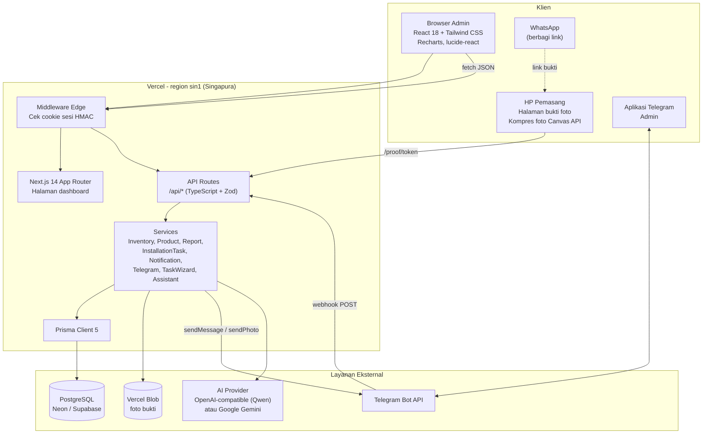

---

## 2. Arsitektur Berlapis

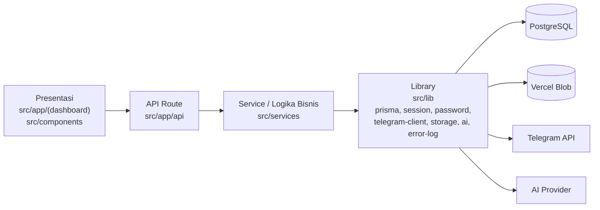

| Folder | Isi |
|---|---|
| `src/app/(auth)` | Halaman login |
| `src/app/(dashboard)` | Dashboard, Barang, Kategori, Barang Masuk/Keluar, Riwayat, Tugas, Laporan, Telegram, Pengguna, Log, Asisten AI, Pengaturan |
| `src/app/proof` | Halaman publik upload foto bukti (tanpa login) |
| `src/app/api` | REST API (JSON) |
| `src/services` | Logika bisnis (transaksi stok, tugas, notifikasi, bot, AI) |
| `src/lib` | Koneksi Prisma, sesi, hash password, klien Telegram, penyimpanan foto, provider AI, log error |
| `src/middleware.ts` | Penjaga akses: hanya admin login yang boleh masuk |
| `prisma/schema.prisma` | Struktur database |

---

## 3. Alur Login & Akses Halaman

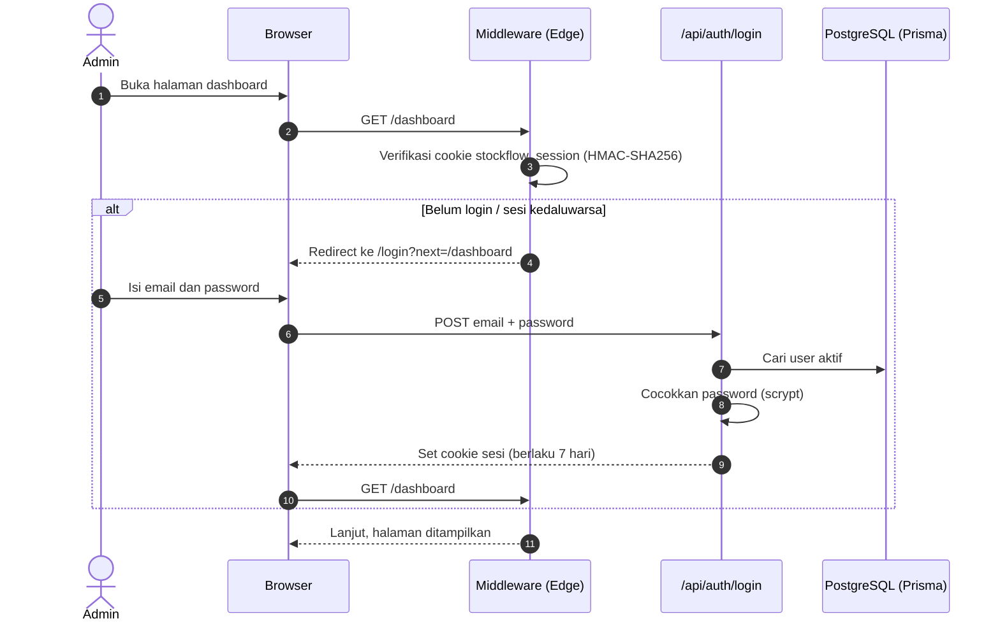

Path publik tanpa login: `/login`, `/proof/*`, `/api/auth/login`, `/api/tasks/proof/*`, `/api/telegram/webhook` (dilindungi secret token), `/api/logs/client`.

---

## 4. Alur Utama: Tugas Pemasangan (Telegram → WhatsApp → Foto → Stok Berkurang)

Ini alur inti sistem. Stok **tidak** langsung berkurang saat tugas dibuat, tetapi saat pemasang mengirim foto bukti.

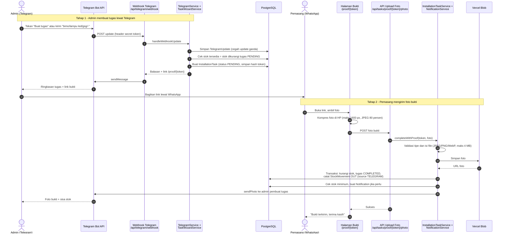

### Status Tugas

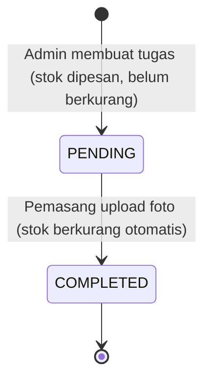

---

## 5. Alur Bot Telegram (Penanganan Pesan)

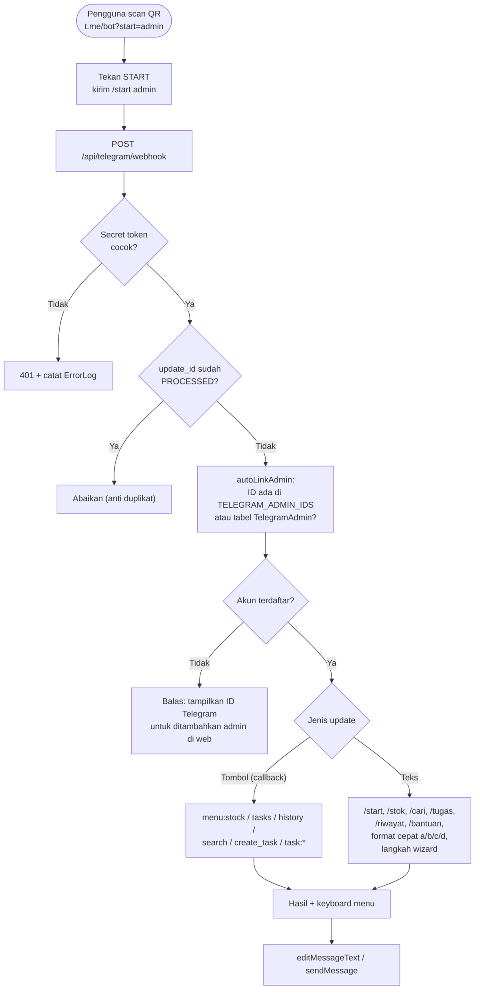

Saat admin membuka halaman **Integrasi Telegram**, sistem memasang deskripsi bot, deskripsi singkat, dan daftar perintah (`setMyDescription`, `setMyShortDescription`, `setMyCommands`) agar pengguna baru tidak melihat chat kosong.

---

## 6. Alur Barang Masuk & Keluar dari Web

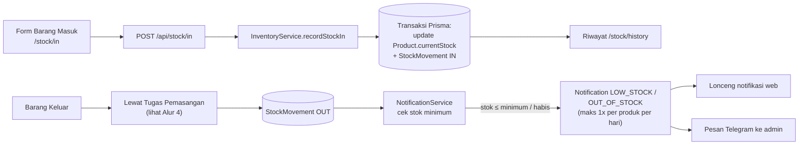

Setiap perubahan stok selalu mencatat `stockBefore` dan `stockAfter` di tabel `StockMovement`, sehingga riwayat bisa diaudit.

---

## 7. Alur Asisten AI (Beta)

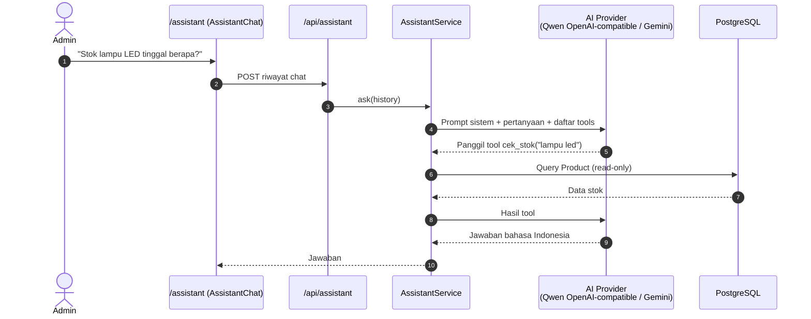

Tools yang tersedia untuk AI (hanya membaca data): `cek_stok`, `cari_tugas_pemasangan`, `riwayat_stok`. Jika model tidak mendukung *tool calling*, sistem mengulang tanpa tools.

---

## 8. Alur Pencatatan Error

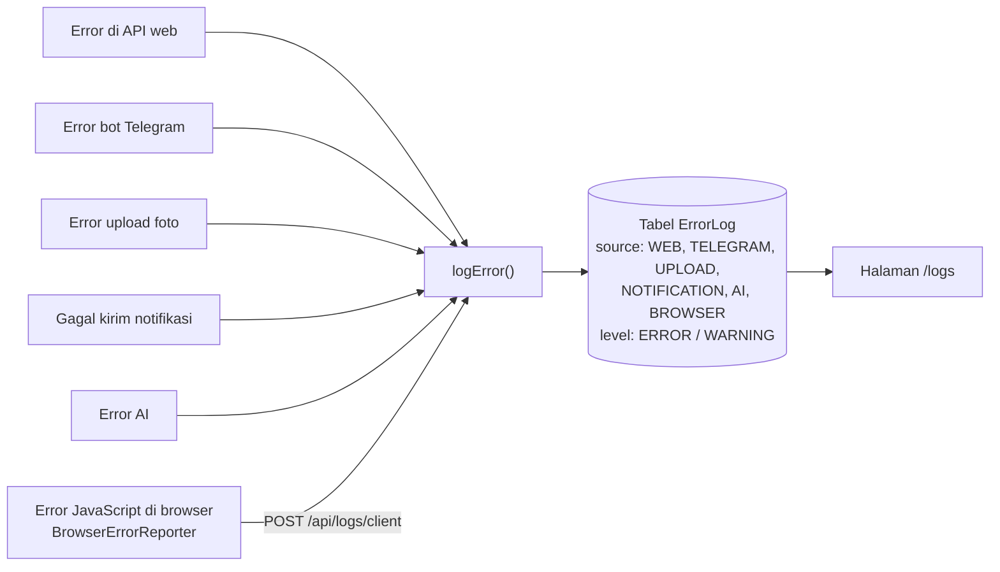

---

## 9. Struktur Data (Ringkas)

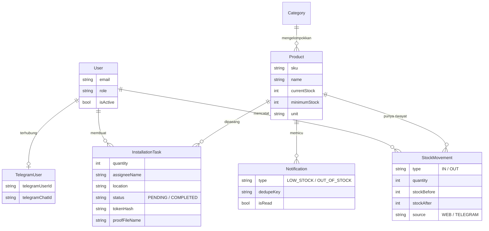

Tabel pendukung lain: `TelegramAdmin` (ID admin yang diizinkan), `TelegramUpdate` (log & anti duplikat webhook), `TelegramConversation` (status wizard bot), `ErrorLog`.

---

## 10. Deployment

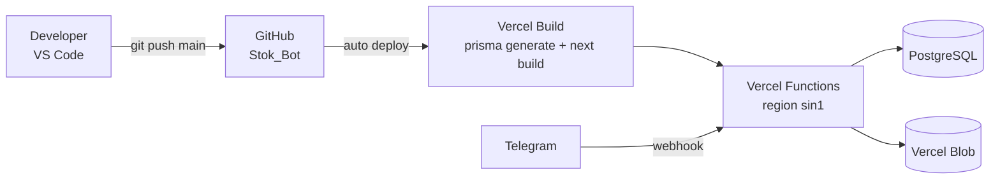

Variabel lingkungan utama: `DATABASE_URL`, `AUTH_SECRET`, `APP_URL`, `TELEGRAM_BOT_TOKEN`, `TELEGRAM_WEBHOOK_SECRET`, `TELEGRAM_BOT_USERNAME`, `TELEGRAM_ADMIN_IDS`, `BLOB_READ_WRITE_TOKEN`, `AI_PROVIDER`, `OPENAI_BASE_URL` / `OPENAI_MODEL` atau `GEMINI_API_KEY`.
