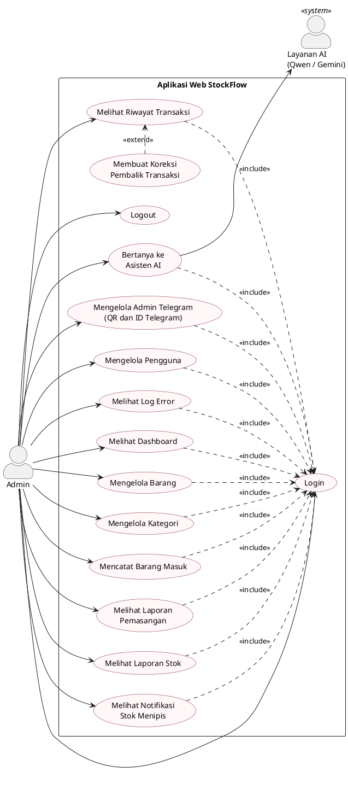
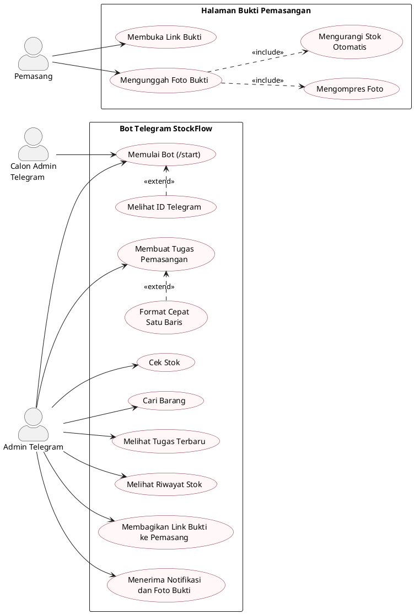
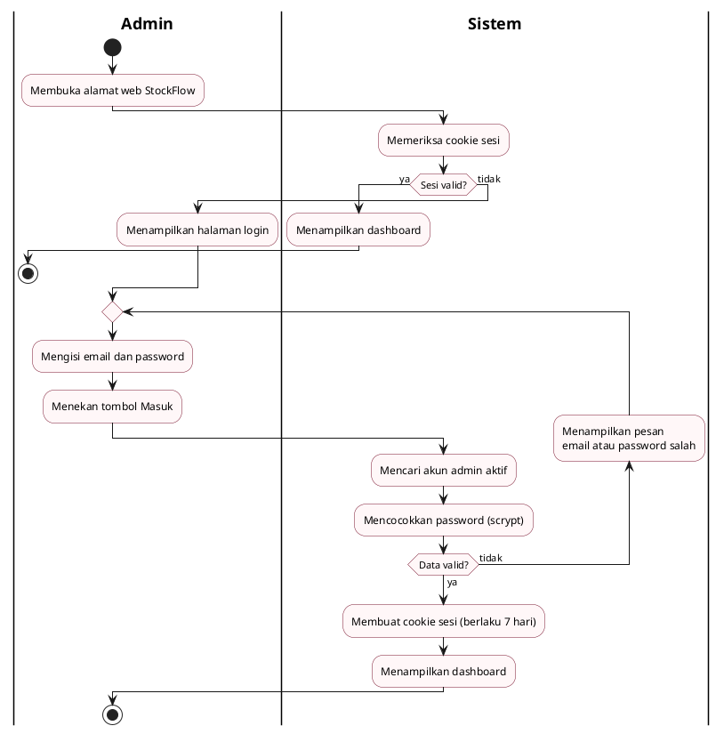
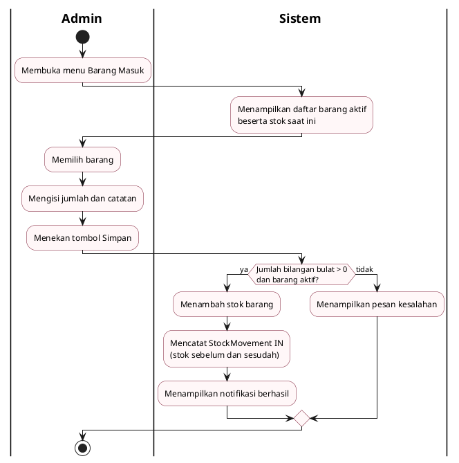
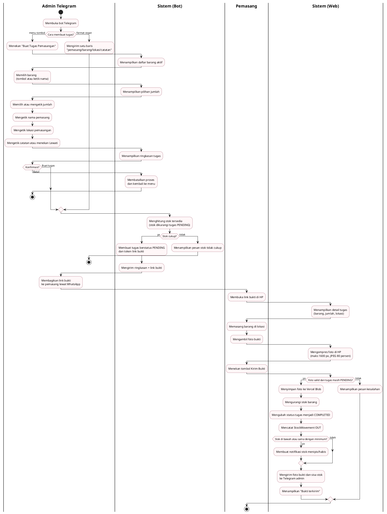
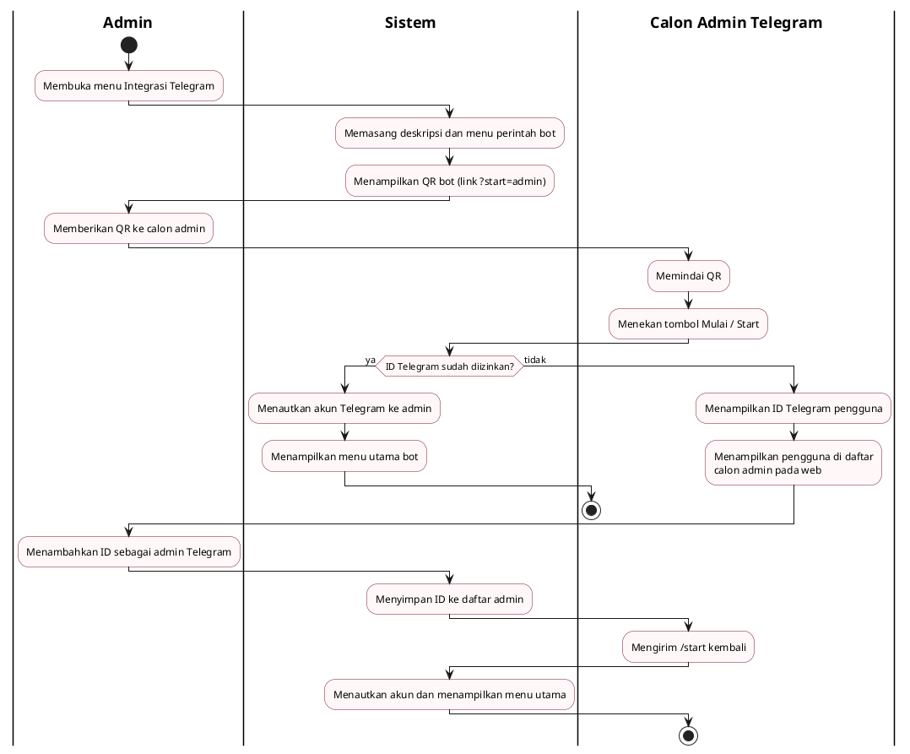
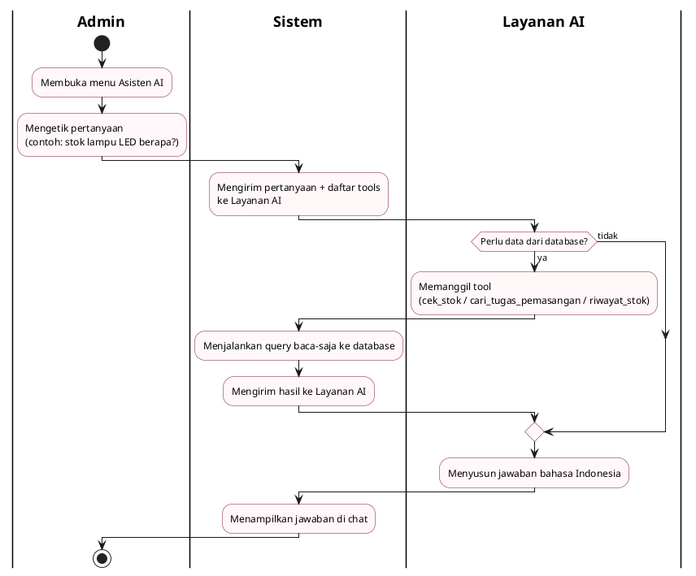

# Use Case & Activity Diagram (PlantUML) - StockFlow

Diagram UML untuk laporan, disusun sesuai fitur yang ada di kode saat ini.

> **Cara copas:**
> 1. Buka https://www.plantuml.com/plantuml/uml (atau ekstensi *PlantUML* di VS Code).
> 2. Salin seluruh isi satu blok, **mulai `@startuml` sampai `@enduml`**.
> 3. Tempel lalu klik **Submit**. Gambar bisa diunduh sebagai PNG atau SVG.
>
> Setiap blok lengkap dan berdiri sendiri.

---

## 1. Use Case Diagram

### Daftar Aktor

| Aktor | Keterangan |
|---|---|
| Admin | Admin gudang yang login ke web |
| Admin Telegram | Admin yang ID Telegram-nya sudah diizinkan, memakai bot |
| Calon Admin Telegram | Pengguna Telegram yang belum terdaftar |
| Pemasang | Petugas lapangan, menerima link lewat WhatsApp, tidak perlu akun |
| Layanan AI | Sistem eksternal (Qwen/Gemini) untuk asisten AI |

### 1a. Use Case Diagram Lengkap

```plantuml
@startuml UseCase_StockFlow
left to right direction
skinparam packageStyle rectangle
skinparam actorStyle awesome
skinparam usecase {
  BackgroundColor #FFF7F8
  BorderColor #7A1630
}
skinparam rectangle {
  BorderColor #7A1630
}

actor "Admin" as Admin
actor "Admin Telegram" as AdminTG
actor "Calon Admin\nTelegram" as Calon
actor "Pemasang" as Pemasang
actor "Layanan AI\n(Qwen / Gemini)" as AI <<system>>

rectangle "Sistem StockFlow" {

  package "Aplikasi Web" {
    usecase "Login" as UC_Login
    usecase "Logout" as UC_Logout
    usecase "Melihat Dashboard" as UC_Dash
    usecase "Mengelola Barang" as UC_Barang
    usecase "Mengelola Kategori" as UC_Kategori
    usecase "Mencatat Barang Masuk" as UC_Masuk
    usecase "Melihat Riwayat Transaksi" as UC_Riwayat
    usecase "Membuat Koreksi\nPembalik Transaksi" as UC_Koreksi
    usecase "Melihat Laporan\nPemasangan" as UC_LapTugas
    usecase "Melihat Laporan Stok" as UC_Laporan
    usecase "Melihat Notifikasi\nStok Menipis" as UC_Notif
    usecase "Mengelola Admin Telegram\n(QR dan ID Telegram)" as UC_KelolaTG
    usecase "Mengelola Pengguna" as UC_User
    usecase "Melihat Log Error" as UC_Log
    usecase "Bertanya ke\nAsisten AI" as UC_AI
  }

  package "Bot Telegram" {
    usecase "Memulai Bot (/start)" as UC_Start
    usecase "Melihat ID Telegram" as UC_LihatID
    usecase "Cek Stok" as UC_Stok
    usecase "Cari Barang" as UC_Cari
    usecase "Melihat Tugas Terbaru" as UC_ListTugas
    usecase "Melihat Riwayat Stok" as UC_RiwayatTG
    usecase "Membuat Tugas\nPemasangan" as UC_Tugas
    usecase "Format Cepat\nSatu Baris" as UC_Cepat
    usecase "Membagikan Link Bukti\nke Pemasang" as UC_Bagikan
    usecase "Menerima Notifikasi\ndan Foto Bukti" as UC_TerimaNotif
  }

  package "Halaman Bukti Pemasangan" {
    usecase "Membuka Link Bukti" as UC_Link
    usecase "Mengunggah Foto Bukti" as UC_Upload
    usecase "Mengompres Foto" as UC_Kompres
    usecase "Mengurangi Stok\nOtomatis" as UC_Kurangi
  }
}

' ===== Admin Web =====
Admin --> UC_Login
Admin --> UC_Logout
Admin --> UC_Dash
Admin --> UC_Barang
Admin --> UC_Kategori
Admin --> UC_Masuk
Admin --> UC_Riwayat
Admin --> UC_LapTugas
Admin --> UC_Laporan
Admin --> UC_Notif
Admin --> UC_KelolaTG
Admin --> UC_User
Admin --> UC_Log
Admin --> UC_AI

UC_Dash ..> UC_Login : <<include>>
UC_Barang ..> UC_Login : <<include>>
UC_Kategori ..> UC_Login : <<include>>
UC_Masuk ..> UC_Login : <<include>>
UC_Riwayat ..> UC_Login : <<include>>
UC_LapTugas ..> UC_Login : <<include>>
UC_Laporan ..> UC_Login : <<include>>
UC_Notif ..> UC_Login : <<include>>
UC_KelolaTG ..> UC_Login : <<include>>
UC_User ..> UC_Login : <<include>>
UC_Log ..> UC_Login : <<include>>
UC_AI ..> UC_Login : <<include>>
UC_Koreksi .> UC_Riwayat : <<extend>>
UC_AI --> AI

' ===== Calon Admin Telegram =====
Calon --> UC_Start
UC_LihatID .> UC_Start : <<extend>>

' ===== Admin Telegram =====
AdminTG --> UC_Start
AdminTG --> UC_Stok
AdminTG --> UC_Cari
AdminTG --> UC_ListTugas
AdminTG --> UC_RiwayatTG
AdminTG --> UC_Tugas
AdminTG --> UC_Bagikan
AdminTG --> UC_TerimaNotif
UC_Cepat .> UC_Tugas : <<extend>>

' ===== Pemasang =====
Pemasang --> UC_Link
Pemasang --> UC_Upload
UC_Upload ..> UC_Kompres : <<include>>
UC_Upload ..> UC_Kurangi : <<include>>
@enduml
```

### 1b. Use Case Diagram Dipecah (opsional, lebih mudah dibaca)

Jika diagram lengkap terlalu padat untuk satu halaman laporan, gunakan dua diagram berikut.

**Use Case Aplikasi Web**

**Use Case Bot Telegram dan Pemasang**

---

## 2. Activity Diagram

Semua activity diagram memakai **swimlane** (kolom per aktor/sistem).

### 2.1 Login Admin

### 2.2 Mencatat Barang Masuk

### 2.3 Membuat Tugas Pemasangan sampai Stok Berkurang (Alur Utama)

### 2.4 Pendaftaran Admin Telegram (Scan QR)

### 2.5 Bertanya ke Asisten AI

